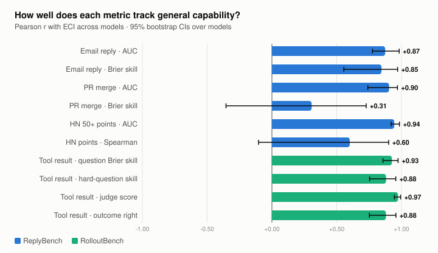

# Experimental benchmarks

Prototype benchmarks for one question: **can a model predict the consequences of its actions?**

Evals of whether a model can *achieve* real-world outcomes (exfiltrate, persuade, make money) are expensive
and dangerous to run. But to act well, a model has to know what its actions will do. So predicting
consequences is a cheap, safe and hard-to-saturate proxy.

Each benchmark here is scored instantly against data the model hasn't seen, uses continuous metrics, and costs
a few dollars per model to run.

| Benchmark | Question | Prototype data | Headline result | |
|---|---|---|---|---|
| **[ReplyBench](replybench/)** | How will *people* respond to an action? | 191 Apache mailing-list threads, 234 GitLab merge requests, 200 Hacker News posts, all after the training cutoff | Ranking skill tracks capability (AUC vs. ECI r = 0.87–0.94); calibration often doesn't | [Landing page →](replybench/) |
| **[RolloutBench](rolloutbench/)** | What will a *tool call* return? | 249 tool calls (930 questions) from 75 real-world agent sessions | 46–74% accuracy across 14 models; tracks capability (r = 0.93–0.97 with ECI) | [Landing page →](rolloutbench/) |

---

## [ReplyBench](replybench/): predicting how people respond

Show a model an action and ask it to predict the response. Three tasks: will anyone reply to this email
thread? Will this merge request be merged within 30 days? How many points will this HN post get?

<a href="replybench/"></a>

- **Ranking skill tracks general capability.** Across 14 Claude models, AUC correlates with the Epoch
  Capabilities Index at r = 0.87 (email), 0.90 (PR) and 0.94 (HN).
- **Replies are predictable, merges less so.** Email AUC is 0.75–0.88. PR AUC is 0.69–0.81, against 0.70
  for a per-project prior, and calibration on merges doesn't improve with capability.
- **Next step:** 1,000+ items per task, and private data (METR's own PRs, email, Slack).

## [RolloutBench](rolloutbench/): predicting what tools return

Take a trace from a real agent session and hide each tool result: shell output, web pages, API responses, GPU
job logs, sub-agent reports, human replies. The model, which has no internet, predicts each one. Scoring is
mainly exact: multiple-choice questions written from the real result. An independent LLM judge gives a second
view.

<a href="rolloutbench/"></a>

- **Far from solved, and well spread.** Accuracy on questions about the real result runs from 46% (Haiku 4.5)
  to 74% (Opus 5.5). Judge scores run from 3.1 to 5.1 out of 10.
- **Tracks capability closely:** r = 0.93 (question score) and 0.97 (judge score) with ECI.
- **Real-world traces are the point.** In a sandbox pilot, code outputs were nearly solved. Unlike
  AgentWorldBench (Qwen, 2026), which uses benchmark-task trajectories, these traces come from real use.

## Do these benchmarks measure general capability?

Correlation of each metric with the Epoch Capabilities Index (ECI) across the 13 Claude models Epoch scores:

<a href="docs/eci.md"></a>

Most metrics track capability strongly. The exceptions are calibration-type measures (PR Brier skill) and noisy
ones (HN points). They may be measuring something different, such as how well a model's base-rate intuitions
are calibrated, or they may need more data. Full table: [`docs/eci.md`](docs/eci.md).

---

## Shared design

- **Unseen ground truth.** Data comes from after the training cutoff, or is private, so nothing has to
  resolve in the future, unlike forecasting benchmarks. See the
  [comparison with FutureSim, ForecastBench, PredictionArena and AgentWorldBench](docs/comparison.md).
- **Continuous scores with uncertainty.** Rank correlations, Brier scores and judge scores rather than
  pass/fail, so improvements show up smoothly. Every model comparison has a 95% bootstrap CI.
- **14 Claude models, colour-coded by tier.** Haiku 4.5 through Fable 5.1; other providers' models aren't
  reachable from this environment.
- **No tools for the predictor.** Models predict from context alone. [`common/llm.py`](common/llm.py) calls
  the Anthropic API when `ANTHROPIC_API_KEY` is set, and otherwise uses the `claude` CLI with tools disabled.
- **One look for all charts.** [`common/svg.py`](common/svg.py) renders dependency-free SVG figures that work
  in light and dark mode.

## Layout

```
common/          model interface, stats, SVG chart helpers
docs/            comparison with existing prediction benchmarks
replybench/      README (landing page), email/ pr/ hn/ tasks, run_binary.py, score_binary.py, make_figures.py
rolloutbench/    README (landing page), real/ (real-world traces), sandbox pilot, make_figures.py, figures/
```

A new benchmark gets its own folder with a README landing page, a `run.py` and `score.py`, and a
`make_figures.py` that writes to its `figures/` folder.
