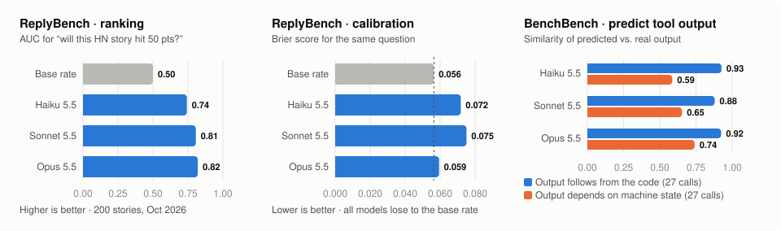

# Can models predict what their actions will do?

**Two prototype benchmarks that score a model on predicting the *consequences of actions*, not world events.**
Both are scored instantly from data the model has never seen, use continuous metrics, and cost under $1 per
model to run.

<p align="center"></p>

## Takeaways

1. **Models know what Hacker News likes, but not how little it cares.** Opus 5.5 picks out stories that will
   reach 50 points with AUC 0.82, yet every model is *worse calibrated than a constant base rate*. A typical
   submission gets 2 points; the models expect far more.
2. **Models already "run code in their heads".** When a tool's output follows from code earlier in the trace
   (SQL aggregates, the sum of primes below 10⁶, unittest failures), all three models reproduce it almost
   perfectly (similarity ≈ 0.9).
3. **The headroom is in the environment.** When the output depends on the machine (Python version, file
   counts, memory), similarity drops to 0.59–0.74, and it scales with model size. That is the part of
   "simulating the world" that agents can't yet do without tools.
4. **Unlike existing forecasting benchmarks, nothing has to resolve.** FutureSim, ForecastBench and
   PredictionArena predict world events, so they wait months or go stale. Here the ground truth already exists
   in held-out data, so a run is scored immediately.

## The two benchmarks

| | **ReplyBench** | **BenchBench** |
|---|---|---|
| Question | *How will people respond to this action?* | *What will this tool call return?* |
| Prototype | Hacker News submissions after the training cutoff: predict points, comments, P(≥50 points) | Agent shell traces: given the trace so far, predict the next command's exact output |
| Example | “Cops Can Bypass iPhone's Automatic Reboot…” (404media) → Opus 5.5 predicted 150 points, actual **293**. “Official Proton Drive CLI” → predicted 120, actual **1**. | `find /usr/lib/python3.13 -name '*.py' \| wc -l` → Haiku 5.5 predicted 537, actual **591** |
| Size | 200 stories, 3 models | 8 traces, 76 tool calls, 3 models |
| Code | [`replybench/`](replybench/) | [`benchbench/`](benchbench/) |

| | FutureSim | ForecastBench | PredictionArena | **ReplyBench** | **BenchBench** |
|---|---|---|---|---|---|
| Predicts | World events | World events | World events, through trading | Response to an action | Effect of an agent's own action |
| Time to score | 0, but goes stale | Weeks to years | Days to weeks | Instant | Instant |
| Cost per run | $50–2,000 | Low | $10k at risk | <$1 | <$1 |

## Next steps to make this real

The prototypes show that the pipelines work and that the scores spread across models. To become a benchmark
people trust, each one needs three things: **data nobody has seen**, **an outcome that is the consequence of
an action**, and **a known noise ceiling**.

### ReplyBench

1. **Use private data.** This is the biggest lever. METR's own records are contamination-proof by
   construction:
   - GitHub PRs: merged? how many review rounds? time to merge?
   - Slack and email: does it get a reply, how fast, what reaction?
   - Issue trackers: does the bug get fixed?

   Partner datasets would do the same at scale: support tickets, sales outreach, ad campaigns.
2. **Get causal data.** A/B-test archives answer the observational-not-causal objection. The task becomes
   "which of these two variants won?", with the audience held fixed. The Upworthy Research Archive (32k
   headline tests) is a public development set; fresh, private A/B results from partner companies would be
   the held-out test set.
3. **Add more public streams with a monthly refresh**, so the benchmark is always past the training cutoff:
   - Hacker News, Reddit, and GitHub PR outcomes in public repos.
   - OpenReview scores (ICLR reviews land each November).
   - Kickstarter funding, Stack Overflow accepted answers.
4. **Measure the noise ceiling.** HN reposts of the same URL give a natural test-retest measurement of how
   predictable an outcome can be at all. Report scores as a fraction of that ceiling.
5. **Score full predictive distributions** (quantiles, then log score). Report discrimination and calibration
   separately, and let models see the empirical distribution so that calibration isn't the whole story.
6. **Plot compute against score.** Give an agent an offline corpus (the author's history, similar past
   posts) and a thinking budget, and plot spend vs. score, as the design doc recommends.

### BenchBench

1. **Use real agent transcripts.** METR has thousands of runs across diverse tasks with many tool types:
   long traces, real environments, and outputs that matter. Most of the value is here. Before sending
   transcripts of held-out tasks to model APIs, check the data-handling rules for eval data.
2. **Broaden the tools:**
   - Web fetches served from a frozen cache.
   - Test suites and compiler errors.
   - ML experiments (loss after N steps) and API responses.
3. **Score only what is informative.**
   - Drop trivial steps, such as file writes.
   - Weight each step by how surprising it is to a weak baseline.
   - Swap raw string similarity for checks on the key facts (exit code, numbers, pass/fail), with
     probabilistic answers.
4. **Measure the ceiling.** Re-run each command to quantify irreducible nondeterminism (timestamps, hashes,
   memory).
5. **Validate the core claim:**
   - Correlate BenchBench scores with agentic task success (e.g. time horizon) across models.
   - Run agents on *simulated* tool outputs and see how far they still get. If you score 100% on BenchBench,
     you don't need the tools.

### Shared

- Port to [Inspect](https://inspect.aisi.org.uk/) and run non-Claude models (GPT, Gemini, open weights).
- Keep a public dev split and a private, rotating test split.
- Grow ReplyBench to ≥2k items and BenchBench to ≥1k steps, so that model differences fall outside the noise
  (the current error bar on Spearman ρ is about ±0.07).

---

## Running

```bash
pip install anthropic                     # optional: used if ANTHROPIC_API_KEY is set, else the `claude` CLI
# ReplyBench
python3 replybench/fetch_hn.py --start 2026-10-01 --end 2026-10-06 --n 200
python3 replybench/run.py --model claude-opus-5-5
python3 replybench/score.py
# BenchBench
python3 benchbench/make_traces.py --model claude-haiku-5-5   # records agent traces for benchbench/tasks.json
python3 benchbench/run.py --model claude-opus-5-5
python3 benchbench/score.py
```

`common/llm.py` is the only model interface. Outside the Anthropic API path, it runs `claude -p` with no
tools, no settings, and an empty working directory.

## ReplyBench-HN

**Data.** 200 stories drawn uniformly at random from all 4,687 HN submissions between 1 and 6 Oct 2026. That
window is after the models' training cutoff. Ground truth comes from the official Firebase API on 12 Oct, so
every story is at least 6 days old and its score has settled. The scores are heavy-tailed: median 2, 90th
percentile 12, and 12 of the 200 stories (6%) reached 50 or more points.

**Protocol.** Each model call covers 25 stories, so a run of one model takes 8 calls. The prompt says the
sample is uniform over all submissions.

| model | Spearman (points) | Spearman (comments) | MAE log(1+points) | Brier P(≥50) | AUC P(≥50) |
|---|---|---|---|---|---|
| baseline: constant median / base rate | 0 | 0 | 0.626 | 0.0564 | 0.5 |
| claude-haiku-5-5 | 0.274 | 0.186 | 1.278 | 0.0718 | 0.742 |
| claude-sonnet-5-5 | 0.321 | 0.218 | 1.320 | 0.0751 | 0.807 |
| claude-opus-5-5 | **0.363** | **0.288** | 1.113 | 0.0594 | **0.820** |

**Reading.**
- **Ranking.** All three models rank stories well above chance, and Opus does best. Its AUC of 0.82 means it
  picks out the stories that later hit 50 points fairly well.
- **Calibration.** All three are badly calibrated. On log-MAE and Brier every model is *worse* than a
  constant baseline, because each one predicts that a typical story gets far more points than it does, even
  though the prompt states the base rate.
- **Discrimination vs calibration.** This is the "on-distribution vs. off-distribution" concern from the
  proposal in a concrete form: the models have a good sense of what HN likes, but not of how little attention
  a typical submission gets.
- **Next step.** A calibration step (e.g. isotonic regression on a held-out split), or telling the model the
  empirical distribution, would separate the two skills.

## BenchBench

**Data.**
- **Traces.** A Claude agent (Haiku 5.5, Bash only, no internet needed) worked each of 8 small tasks in
  `benchbench/tasks.json`: Collatz statistics, machine info, SQLite queries, a C prime sieve, building a git
  repo, text statistics, a unittest bugfix, and exploring the Python stdlib.
- **One command per step.** The agent was told to make one Bash call per step. Without that instruction it
  bundled each task into a single script run.
- **Size.** 76 tool calls in total. 54 of them have non-empty output; the rest are things like file writes
  that print nothing.
- **Path cleanup.** The random sandbox path is rewritten to `/sandbox`.

**Protocol.** For step *k*, the model sees the task, steps 1..*k*−1 with their true outputs (each truncated to
1,500 characters), and command *k*. It then writes the predicted output. That is one call per step, so 76
calls per model.

**Scoring.**
- `similarity` is the difflib ratio between the predicted and true output, over the first 3,000 characters,
  on a 0–1 scale.
- `exact` is an exact string match after stripping whitespace.
- "Non-trivial" excludes steps whose true output is the no-output marker.

| model | similarity (all) | similarity (non-trivial) | exact (all) | exact (non-trivial) |
|---|---|---|---|---|
| baseline: always "(no output)" | 0.372 | 0.117 | 0.289 | 0 |
| baseline: repeat previous output | 0.297 | 0.135 | 0.184 | 0 |
| claude-haiku-5-5 | 0.735 | 0.756 | 0.461 | 0.37 |
| claude-sonnet-5-5 | 0.834 | 0.766 | 0.553 | 0.37 |
| claude-opus-5-5 | **0.881** | **0.832** | 0.553 | 0.37 |

Mean similarity on non-trivial steps, by task:

| model | collatz | sysinfo | sqlite | c_program | git_repo | text_stats | bugfix | pystdlib |
|---|---|---|---|---|---|---|---|---|
| claude-haiku-5-5 | 0.87 | 0.59 | 1.00 | 1.00 | 0.88 | 1.00 | 0.95 | 0.57 |
| claude-sonnet-5-5 | 0.84 | 0.65 | 1.00 | 1.00 | 0.85 | 0.97 | 0.78 | 0.66 |
| claude-opus-5-5 | 0.85 | 0.74 | 1.00 | 1.00 | 0.88 | 0.99 | 0.96 | 0.73 |

**Reading.** The benchmark splits cleanly into two kinds of step.

- **Pure computation is already nearly solved.** Examples are the SQLite aggregates, the sum of primes below
  10⁶ (37550402023), and unittest output. All three models reproduce these exactly; they "run the code in
  their head".
- **Environment state is where the headroom is.** Examples are the Python version, the stdlib file count,
  `wc -l` of `typing.py`, and `free -h`. On these, models guess plausible but wrong values; Haiku, for
  instance, guessed Python 3.13.5 and the path `/usr/local/lib/python3.12`.
- **Spread.** Larger models are better at inferring environment details from earlier outputs in the trace,
  which is where most of the gap between models comes from.

**Making it harder and more informative.**
- Use longer, real agent traces. Raw METR task transcripts would be ideal.
- Include tools whose results are less deterministic, such as web fetches from a frozen cache, test suites,
  and experiments.
- Weight steps by how hard they are to guess, e.g. by the information content of the output.

## Full comparison with existing prediction benchmarks

| | **FutureSim** (Goel et al. 2026) | **ForecastBench** (Karger et al.) | **PredictionArena** (Zhang et al. 2026) | **ReplyBench-HN** (this repo) | **BenchBench** (this repo) |
|---|---|---|---|---|---|
| What is predicted | Short-answer questions about world events. An agent replays the news day by day (24 Dec 2025 – Mar 2026) and updates its forecasts. | Binary probabilities on future events: market questions plus questions generated from time-series data (FRED, ACLED, Wikipedia, …) | Nothing stated explicitly. Agents trade Kalshi and Polymarket markets with real money ($10k each). | Community response to a post: points, comments, P(≥50 points) | Exact output of the next tool call in an agent trace |
| Source of ground truth | 330 questions generated from Al Jazeera articles in CCNews | Market resolutions and data releases | Market settlements | HN API | Recorded tool outputs |
| Effects of *own actions*? | No (world events) | No (world events) | Partly: P&L depends on the agent's trades, but it is predicting the world | Yes in kind: the effect of an action (posting) on people | Yes: the effect of the agent's own actions on its environment |
| Delay before scoring | None when evaluated, but it goes stale once models are trained past Mar 2026 | Weeks to years (horizons from 7 days to 10 years) | Days to weeks (study ran 57 days) | About a week of data collection, then instant | Instant (traces are recorded once) |
| Contamination control | Window after training cutoff, plus a date-gated search corpus in a sandbox | Fully live (only unresolved questions) | Fully live | Window after training cutoff; refresh by pulling new weeks | Fresh traces on a fresh machine; outputs are machine-specific |
| Scoring | Top-1 accuracy, Brier skill score | Brier score, now a difficulty-adjusted "Brier Index" | Return, settlement win rate | Spearman, log-MAE, Brier, AUC (continuous) | String similarity, exact match (continuous) |
| Cost per model run | High: an agentic multi-month replay, roughly $50–2,000 | Low (plain LLM calls), but you wait for resolution | High: real capital at risk plus agent compute | Very low: 8 calls | Low: 76 calls |
| Headline result | Best: GPT-5.5 in Codex, ~25% accuracy. Open models have negative Brier skill score. | Top AI systems are roughly at superforecaster parity (FRI, Jul 2026); disputed on market questions | Every model in the main cohort lost money on Kalshi (−16% to −31%) | Opus ρ = 0.36, AUC 0.82, but worse calibrated than a constant | Opus 0.88 similarity; computation is near-solved, environment state is not |
| Saturation risk | Medium (accuracy ~25%) | Near-saturated relative to the human reference | Noisy, so hard to tell | Low: irreducible noise caps achievable ρ well below 1 | Low if traces include genuinely unpredictable environment state |

**Takeaways.**
- **Prediction target.** All three existing benchmarks predict *world events*. ReplyBench and BenchBench
  instead predict the *consequences of a specific action*, which is the capability that matters for an agent
  pursuing goals.
- **Scoring delay.** The existing benchmarks have to wait for the world to resolve (ForecastBench,
  PredictionArena) or go stale (FutureSim). Both prototypes here are scored at once, because the ground truth
  already exists in a dataset nobody has seen.
- **What that buys.** Benchmark runs are cheap and repeatable.
- **What it costs.**
  - The private dataset has to stay private and fresh.
  - For ReplyBench, the setup is observational rather than causal.
- Sources for the comparison: arXiv 2605.15188 (FutureSim), arXiv 2409.19839 and forecastbench.org
  (ForecastBench), and arXiv 2604.07355 (PredictionArena). Figures are as reported by the authors and were not
  re-verified here.

## Caveats

- **Sample size.** Both benchmarks are small, so differences between models are noisy. For example, the
  standard error on Spearman ρ with n = 200 is about 0.07.
- **Leakage between traces and the predictor.** The same model family (Claude Haiku) generated the BenchBench
  traces, so commands are in a style the predictors find familiar.
- **Nondeterministic outputs.** Timestamps and memory figures put a ceiling on achievable similarity, and the
  benchmark doesn't measure that ceiling yet. Re-running each command would estimate it.
- **Batched predictions.** ReplyBench predicts 25 stories per call, so the model can calibrate them against
  each other within a batch.
