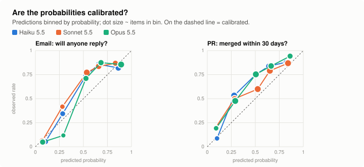
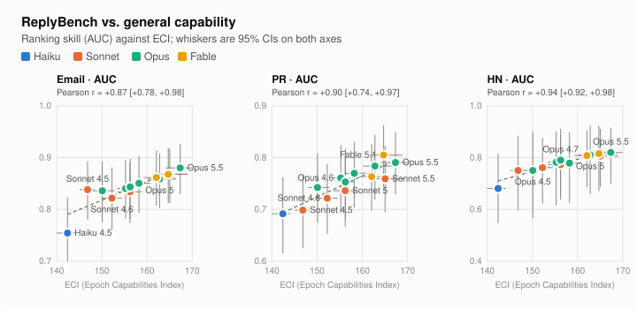

# ReplyBench

**Can a model predict how people will respond to what it does?** Show the model an action (an email, a
merge request, a post) and ask it to predict the response: will anyone reply, will it be merged, will
people upvote it? The ground truth already sits in public data from after the model's training cutoff, so
nothing has to resolve in the future.

[← all benchmarks](../README.md) · [how it compares](../docs/comparison.md)

| Task | The action | The response to predict | Data | n |
|---|---|---|---|---|
| **Email** | A new thread on an Apache mailing list | Does anyone other than the sender reply? | 66 public `@apache.org` lists, Aug – mid-Sep 2026 | 191 |
| **PR** | A merge request on an open-source project | Is it merged within 30 days? | 20 GitLab projects (Mesa, GTK, KDE Plasma, Inkscape, KiCad, …), opened Jul–Aug 2026 | 234 |
| **HN** | A Hacker News submission | Points, comments, P(≥ 50 points) | Random HN stories, 1–6 Oct 2026 | 200 |

<p align="center"></p>

## Takeaways

- **Ranking skill tracks general capability closely.** Across 14 Claude models, the newer and larger ones
  are better at telling which emails get replies, which MRs get merged and which posts take off. Against the
  Epoch Capabilities Index, AUC correlates at r = 0.87 (email), 0.90 (PR) and 0.94 (HN).
- **Reply prediction is strong for every model.** Email AUC is 0.75–0.88, well ahead of the base rate
  (Brier skill +0.21 to +0.47). It isn't just subject tags: on emails without a `[VOTE]`/`[DISCUSS]`-style
  tag, Opus 5.5's AUC is about 0.89.
- **Merge prediction is harder, and calibration there doesn't improve with capability.** PR AUC is 0.69–0.81,
  against 0.70 for a per-project merge-rate prior. On Brier skill, most models only roughly match that prior
  (+0.11), and Brier skill doesn't track ECI (r = 0.31, CI spans zero). Fable 5.1 is the exception (+0.25).
- **Calibration depends on the setting.** On HN, every model expects far more attention than a typical post
  gets, so all are worse than the base rate; older models are much worse. On email and MRs, models are
  under-confident (see the reliability chart below).
- **Single-model differences are mostly within the noise at n ≈ 200.** The capability trend shows up clearly
  across 14 models, but separating neighbouring models needs about 1,000+ items per task.

<p align="center"></p>

## Why this matters

An agent pursuing a goal, whether that's persuading, organising, selling or attacking, has to predict how
people will react to each thing it does. Accurately predicting the effects of actions is a prerequisite for
taking good actions. ReplyBench measures that directly and cheaply, without anyone having to take the
actions.

## The three tasks

### Email: will anyone reply? ([`email/`](email/))

- **Data.** All Apache Software Foundation mailing lists are public. We took the 80 most active `user@`,
  `users@` and `dev@` lists, collected every human-written email that started a thread between 1 Aug and
  15 Sep 2026, and sampled up to 6 per list. Bot traffic is filtered out: JIRA, GitHub, CI and git-commit
  notifications.
- **Label.** Whether anyone other than the sender replied, checked about 6 weeks later. 58% got a reply.
- **Inputs.** The model sees the list, sender, date, subject and body, and gives P(reply).
- **Examples (Opus 5.5).**
  - "[VOTE] Release Apache Avro 1.12.2 RC2" (dev@avro): Opus said 95% reply, but nobody replied. The RC was
    superseded by RC3, the kind of context a model can't see.
  - Votes and design discussions are rated highly and usually do get replies. Announcements and board
    reports are rated low.

### PR: merged within 30 days? ([`pr/`](pr/))

- **Data.** GitHub's API isn't reachable from our environment, so this uses four public GitLab instances:
  GitLab.com, freedesktop, GNOME and KDE.
  - Up to 12 human-authored MRs were sampled per project from *all* MRs opened between 15 July and
    31 Aug 2026, whatever happened to them, so there's no survivorship bias.
  - Label: merged within 30 days. 65% were.
- **Inputs.** The model sees the project, author, title, description, draft flag, the number of files
  changed and the first ~1,500 characters of the diff, and gives P(merge).
- **Examples (Opus 5.5).**
  - "Draft: Test merge request, please ignore." (GTK): 2%, correct.
  - "Qt: Add packet list column freezing and row pinning" (Wireshark): 12%, but it was merged. A large UI
    feature from an outside contributor looks risky, yet Wireshark merges nearly everything.

### HN: how much attention will a post get? ([`hn/`](hn/))

- **Data.** 200 stories drawn uniformly at random from all 4,687 HN submissions between 1 and 6 Oct 2026.
- **Inputs and outputs.** The model sees the title, domain, author and time, and predicts points, comments
  and P(≥ 50 points).

## Results across 14 models

95% bootstrap CIs over items; best in bold.

| model | Email AUC | Email Brier skill | PR AUC | PR Brier skill | HN AUC | HN Spearman (points) |
|---|---|---|---|---|---|---|
| Haiku 4.5 | 0.75 [0.68, 0.82] | +0.21 [+0.09, +0.32] | 0.69 [0.62, 0.76] | +0.12 [+0.03, +0.20] | 0.68 [0.55, 0.82] | 0.20 [0.06, 0.33] |
| Haiku 5.5 | 0.84 [0.77, 0.89] | +0.33 [+0.21, +0.45] | 0.77 [0.70, 0.83] | +0.03 [-0.14, +0.16] | 0.74 [0.59, 0.88] | 0.27 [0.14, 0.40] |
| Sonnet 4.5 | 0.84 [0.78, 0.89] | +0.32 [+0.20, +0.43] | 0.70 [0.63, 0.77] | +0.11 [-0.00, +0.21] | 0.75 [0.60, 0.88] | 0.28 [0.15, 0.41] |
| Sonnet 4.6 | 0.82 [0.76, 0.88] | +0.27 [+0.15, +0.39] | 0.72 [0.65, 0.79] | +0.08 [-0.06, +0.20] | 0.76 [0.62, 0.88] | 0.30 [0.17, 0.43] |
| Sonnet 5 | 0.83 [0.77, 0.89] | +0.37 [+0.26, +0.48] | 0.74 [0.67, 0.80] | +0.17 [+0.05, +0.28] | 0.77 [0.65, 0.89] | 0.35 [0.23, 0.47] |
| Sonnet 5.5 | 0.87 [0.81, 0.92] | +0.37 [+0.24, +0.48] | 0.76 [0.69, 0.82] | +0.14 [+0.00, +0.26] | 0.81 [0.69, 0.91] | 0.32 [0.19, 0.45] |
| Opus 4.5 | 0.84 [0.78, 0.89] | +0.38 [+0.26, +0.48] | 0.74 [0.68, 0.81] | +0.19 [+0.09, +0.27] | 0.75 [0.57, 0.90] | 0.27 [0.13, 0.39] |
| Opus 4.6 | 0.84 [0.78, 0.90] | +0.37 [+0.24, +0.48] | 0.76 [0.69, 0.82] | +0.18 [+0.05, +0.30] | 0.78 [0.62, 0.90] | 0.32 [0.19, 0.45] |
| Opus 4.7 | 0.84 [0.78, 0.90] | +0.40 [+0.27, +0.51] | 0.75 [0.68, 0.82] | +0.15 [+0.01, +0.27] | 0.79 [0.64, 0.91] | 0.33 [0.20, 0.45] |
| Opus 4.8 | 0.85 [0.79, 0.90] | +0.39 [+0.27, +0.50] | 0.77 [0.70, 0.83] | +0.15 [+0.01, +0.26] | 0.78 [0.63, 0.90] | 0.34 [0.22, 0.47] |
| Opus 5 | 0.86 [0.80, 0.91] | +0.42 [+0.29, +0.53] | 0.78 [0.72, 0.84] | +0.16 [+0.01, +0.29] | 0.81 [0.66, 0.92] | 0.33 [0.20, 0.46] |
| Opus 5.5 | **0.88 [0.83, 0.93]** | **+0.47 [+0.35, +0.57]** | 0.79 [0.73, 0.85] | +0.11 [-0.06, +0.23] | **0.82 [0.70, 0.92]** | **0.36 [0.23, 0.49]** |
| Fable 5 | 0.86 [0.81, 0.91] | +0.44 [+0.31, +0.55] | 0.76 [0.70, 0.83] | +0.15 [+0.01, +0.28] | 0.81 [0.69, 0.91] | 0.26 [0.12, 0.39] |
| Fable 5.1 | 0.87 [0.81, 0.92] | +0.46 [+0.33, +0.57] | **0.81 [0.74, 0.86]** | **+0.25 [+0.13, +0.36]** | 0.82 [0.67, 0.92] | 0.28 [0.14, 0.41] |
| *baseline: base rate* | – | +0.00 | – | +0.00 | 0.50 | 0.00 |
| *baseline: project merge rate* | – | – | 0.70 [0.63, 0.77] | +0.11 [+0.01, +0.21] | – | – |

<p align="center"></p>

Full tables per task: [`email/results/scores.md`](email/results/scores.md), [`pr/results/scores.md`](pr/results/scores.md),
[`hn/results/scores.md`](hn/results/scores.md). All metric–ECI correlations: [`docs/eci.md`](../docs/eci.md).

<p align="center"></p>

## Next steps

1. **Scale each task to 1,000+ items** so that differences between models fall outside the CIs.
2. **Use private data.** METR's own email, Slack and PRs are contamination-proof and are exactly "the
   response to an action". Gmail and Slack connectors exist, but only with the people involved agreeing.
3. **Get causal data.** A/B-test archives answer the observational-not-causal objection: "which of two
   variants won?", with the audience held fixed.
4. **Predict richer responses:** time to reply, the content of the reply, review comments, and the
   reviewer's verdict.
5. **Add GitHub PRs** where API access is available. GH Archive is reachable and could provide outcomes at
   scale.

## Caveats

- **Observational data.** The sender's identity, the timing and the project all confound the effect of the
  content itself.
- **Batching.** Items are predicted in batches (10 emails, 5 MRs, or 25 HN stories per call), so a model can
  calibrate them against each other.
- **Email selection.** The most active lists are mostly `dev@` lists, so email covers developer
  communication more than user questions.
- **Not every bot is caught.** Nine automated git-commit emails slipped past the first filter; they were
  removed and the filter fixed.

## Running

```bash
python3 replybench/email/fetch.py && python3 replybench/pr/fetch.py      # build datasets
python3 replybench/run_binary.py --task email --model claude-opus-5-5     # predict (also --task pr)
python3 replybench/score_binary.py --task email                           # scores + CIs (also --task pr)
python3 replybench/hn/fetch.py && python3 replybench/hn/run.py --model claude-opus-5-5 && python3 replybench/hn/score.py
python3 replybench/make_figures.py                                        # figures/
```
