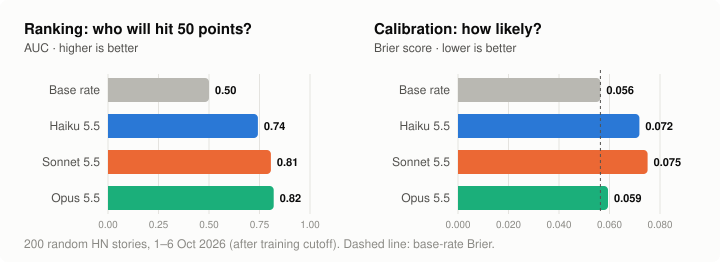
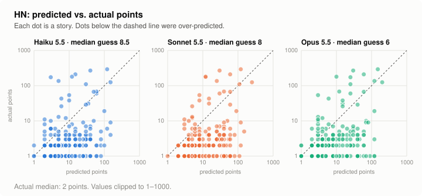

# ReplyBench

**Can a model predict how people will respond to what it does?** Show the model an action (an email, a
pull request, a post, a paper) and ask it to predict the response: a click, a reply, a merge, an upvote, a
referee's verdict. The ground truth already sits in a dataset the model hasn't seen.

[← all benchmarks](../README.md) · [how it compares](../docs/comparison.md)

<p align="center"></p>

## Takeaways

- **Models know what Hacker News likes…** All three rank stories well above chance. Opus 5.5 picks out the
  stories that go on to reach 50 points with an AUC of 0.82.
- **…but not how little it cares.** Every model's probabilities are *worse* than a constant base rate. A
  typical submission gets 2 points; the models' median guesses are 6–8.5 points, even though the prompt says
  the sample is random.
- **This is the "off-distribution" worry, made concrete.** Models are tuned to the visible, successful part of
  the distribution (front-page stories) and overestimate attention everywhere else. Telling good from bad is
  one skill; knowing the absolute level is another.

<p align="center"></p>

## Why this matters

An agent pursuing a goal, whether that's persuading, organising, selling or attacking, has to predict how
people and systems will react to each thing it does. Accurately predicting the effects of actions is a
prerequisite for taking good actions. ReplyBench measures that ability directly, cheaply, and without
anyone having to take the actions.

The response being predicted could be:

| Action | Response to predict | Data source |
|---|---|---|
| A post or ad | Points, comments, clicks, shares | **Hacker News (this prototype)**, Reddit, A/B-test archives |
| An email or Slack message | Reply? How fast? Yes or no to the ask? | Private mailboxes and workspaces |
| A pull request | Merged? Review rounds? | GitHub |
| A paper | Referee scores, citations | OpenReview, Semantic Scholar |
| A support ticket or bug report | Resolved? How long? | Issue trackers |

## The prototype: Hacker News

- **Data.** 200 stories drawn uniformly at random from all 4,687 HN submissions between 1 and 6 Oct 2026,
  after the models' training cutoff. Ground truth is each story's score and comment count, read from the
  official API 6+ days later, when they had settled.
- **Inputs.** The model sees the title, domain, author and posting time (and the text, for text posts).
- **Outputs.** It predicts the final points, the comment count, and P(points ≥ 50).
- **Batching.** Stories are batched 25 per call, so a full run is 8 calls per model, under $1.

| model | Spearman (points) | Spearman (comments) | MAE log(1+points) | Brier P(≥50) | AUC P(≥50) |
|---|---|---|---|---|---|
| baseline: constant median / base rate | 0 | 0 | **0.626** | **0.0564** | 0.5 |
| claude-haiku-5-5 | 0.274 | 0.186 | 1.278 | 0.0718 | 0.742 |
| claude-sonnet-5-5 | 0.321 | 0.218 | 1.320 | 0.0751 | 0.807 |
| claude-opus-5-5 | **0.363** | **0.288** | 1.113 | 0.0594 | **0.820** |

Two examples from Opus 5.5:
- “Cops Can Bypass iPhone's Automatic Reboot to Get into Locked Phones” (404media): predicted 150 points,
  actual **293**. The direction was right.
- “Official Proton Drive CLI” (proton.me): predicted 120 points, actual **1**.

## Next steps

1. **Use private data.** This is the biggest lever. METR's own PRs, Slack and email, and issue trackers are
   contamination-proof by construction, and they are exactly "the response to an action".
2. **Get causal data.** A/B-test archives answer the observational-not-causal objection: "which of these two
   variants won?" with the audience held fixed. The Upworthy archive could be a development set, with fresh
   private A/B results as the test set.
3. **Refresh monthly from public streams:** Hacker News, Reddit, PR outcomes in public repos, OpenReview
   scores.
4. **Measure the noise ceiling.** HN reposts of the same URL show how predictable an outcome is at all.
5. **Score full distributions** (quantiles, log score). Report ranking and calibration separately, and plot
   spend against score with retrieval and thinking budgets.

## Caveats

- **Sample size.** n = 200, so the standard error on Spearman ρ is about 0.07.
- **Batching.** Stories are predicted 25 per call, so a model can calibrate them against each other.
- **Observational data.** The author and timing confound the effect of the content itself.

## Running

```bash
python3 replybench/fetch_hn.py --start 2026-10-01 --end 2026-10-06 --n 200   # sample stories + outcomes
python3 replybench/run.py --model claude-opus-5-5                             # predict
python3 replybench/score.py                                                   # tables
python3 replybench/make_figures.py                                            # figures/
```
